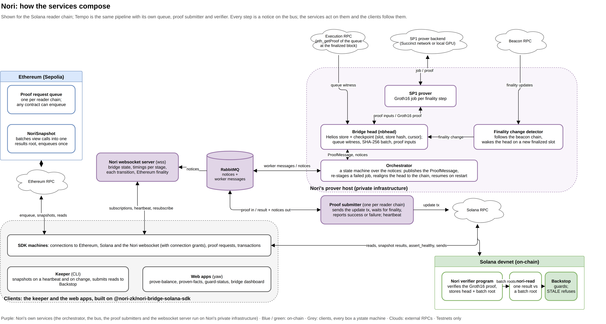

# Nori: read Ethereum state from Solana and Tempo

> Hub repo for Nori's Crypto World's Fair entry. Each folder is a git submodule pinned to an exact
> commit; the links below work without cloning. To get everything:
> `git clone --recurse-submodules https://github.com/Nori-zk/nori-worldsfair`.

Nori is infrastructure for reading Ethereum state from Solana and Tempo, proven instead of
relayed: no signers, oracles or multisig in between. Helios, an Ethereum light client, runs
inside the SP1 zkVM; one Groth16 proof covers Ethereum's finality and the requests queued on
Ethereum, including the results root that `NoriSnapshot` commits for a batch of view calls. The
reader chain verifies the proof once, and any program there checks a single answer against it in
one call. Bridges today ask you to trust whoever relays Ethereum's state; Nori replaces the
relayer with a proof. The first consumer is **Backstop**, a circuit breaker for bridged assets:
it trips when a token's proven backing on Ethereum falls below its supply.

## Three tracks: Ethereum, Solana, Tempo

This only works because Ethereum's consensus can be followed by a light client: a sync committee
signs each block header, so a client that checks those signatures and the finality updates knows
Ethereum's finalized state without trusting an RPC. Nori runs that check inside a zkVM and turns
it into one proof. Nothing in it is specific to the reader chain, so the same design carries to
any EVM ecosystem; Tempo is the first port.

- **Ethereum (Sepolia):** the chain that is proven: its finalized state, the proof request queue
  and `NoriSnapshot`, which batches any view calls (a balance, a pause flag) into one request.
- **Solana (devnet):** live on real proofs since 7 Oct. The Nori verifier program checks each
  proof, `nori-read` checks one answer in about 3,200 CU, Backstop and four web apps use it.
- **Tempo:** a similar proof (its own queue and its own Groth16 proof from the same Helios-in-SP1
  program). Ported contracts pass local dry runs; not deployed (see [Tempo](#tempo)).

## What is live (testnets only)

- **Ethereum Sepolia to Solana devnet on real Groth16 proofs since 7 Oct 2026.**
- **10-hour soak (7-8 Oct):** 39 of 39 snapshots proven and applied; median 18 min (15-22) from
  Ethereum block to Solana, almost all of it Ethereum finality.
- **Proof queue:** 168 of 169 requests proven, 152 batches (11 Oct, 22:59 UTC; the one waiting
  was the soak's first snapshot).
- **Backstop keeper:** on its own server, in a 7-day soak since 12 Oct.
- **Four web apps hosted**, reading Sepolia and Solana devnet live ([Try it](#try-it)).
- **Tempo:** not deployed; runs end to end on local chains.

| What | Network | Address |
| --- | --- | --- |
| Proof request queue | Sepolia | [`0x9AeAc0174f7bDf397C6dB1f62c120E8170e5B87e`](https://sepolia.etherscan.io/address/0x9AeAc0174f7bDf397C6dB1f62c120E8170e5B87e) |
| NoriSnapshot (batched view calls) | Sepolia | [`0xC377EbBF516a9DB2Fe5AEB65fA19D4dca1717340`](https://sepolia.etherscan.io/address/0xC377EbBF516a9DB2Fe5AEB65fA19D4dca1717340) |
| Nori verifier program (verifies proofs, stores batch roots) | Solana devnet | [`EUz5RMQxYkc9zu12wpCDu9syvr4MarghoYb6jHAvdAcg`](https://explorer.solana.com/address/EUz5RMQxYkc9zu12wpCDu9syvr4MarghoYb6jHAvdAcg?cluster=devnet) |
| Backstop | Solana devnet | [`JAZNGzLyN1TKhjnDDKrSsaQveAhUZUjiG8usM9Du5UD9`](https://explorer.solana.com/address/JAZNGzLyN1TKhjnDDKrSsaQveAhUZUjiG8usM9Du5UD9?cluster=devnet) |
| nori-read-example | Solana devnet | [`5tA2aWbrP7JaKtcP2sJTp676TbFc6MEF7hcWCo9KqhS7`](https://explorer.solana.com/address/5tA2aWbrP7JaKtcP2sJTp676TbFc6MEF7hcWCo9KqhS7?cluster=devnet) |

SP1 program vkey (pinned on-chain at initialize):
`0x00e51197676aceacae2d0b4810c9f421b5b47a86b55031dcbe034ef4cee2a6a7`.
Full address list, demo mints and guards: [submission-solana/docs](https://github.com/Nori-zk/nori-worldsfair-submission/blob/develop/docs/README.md).

## How it works

1. **Ask on Ethereum.** A contract enqueues a request on the proof request queue. NoriSnapshot
   batches any Ethereum view calls into one results root and enqueues one request.
2. **Prove.** Nori's bridge head follows Ethereum finality with Helios inside SP1, drains the
   queue into a SHA-256 Merkle batch and produces one Groth16 proof.
3. **Verify.** On Solana, the Nori verifier program checks the Groth16 proof with Nori's SP1 v6
   fork of `sp1-solana`, then stores the new light-client head and appends the batch root. On
   Tempo, `NoriTempoTokenBridge` does the same with Succinct's SP1 Solidity verifier (local
   only). Anyone can submit a proof (`update` is permissionless).
4. **Read.** `nori-read` (Rust, Solana) or `NoriRead.sol` (Tempo) checks one snapshot result
   against a proven batch root. Backstop, prove-balance and the token migration are consumers.

Each reader chain has its own proof request queue and its own Groth16 proof from the same
Helios-in-SP1 program: the Solana and Tempo branches of the prover share the guest program, its
ELF and its vkey.

## Repo map

One row per submodule, each pinned to an exact commit; plain links, so nobody needs to init them.
"Before" means before the hackathon started (2026-09-14 15:00 UTC); figures from `git log`.

| Path | What it is | Talks to | Before / during the hackathon |
| --- | --- | --- | --- |
| [`submission-solana`](https://github.com/Nori-zk/nori-worldsfair-submission) | Solana submission: NoriSnapshot, `nori-read`, Backstop, `nori-read-example`, the keeper (`keeper/`), four web apps, dry-run and soak scripts | NoriSnapshot enqueues on sdk-solana's Sepolia queue; `nori-read` checks results against the batch roots sdk-solana's program stores; the keeper and apps use the sdk-solana npm SDK and its Rust crates | All during (repo starts 6 Oct; 146 commits at `e8569a1`) |
| [`submission-tempo`](https://github.com/Nori-zk/nori-worldsfair-submission-tempo) | Tempo submission: `NoriRead.sol` and Backstop in Solidity, the token migration (contracts, CLI, dry run, migrate app), the keeper, prove-balance app and bridge dashboard | The same on Tempo, through sdk-tempo's `NoriTempoTokenBridge` and npm SDK | All during (forked from the Solana submission 9 Oct; 64 commits at `c216a2d`) |
| [`sdk-solana`](https://github.com/Nori-zk/nori-solana-sdk) | Nori verifier program (Anchor), proof submitter, CLI, Ethereum contracts (proof request queue), TS SDK | Verifies bridge-head-solana's proofs with sp1-solana; uses bridge-head's crates (hashing, vkey, primitives); the SDK follows the prover's websocket | Before: a 3-commit stub program (332 lines of Rust); the proof request queue's design comes from the prover's pre-hackathon work. During: 37 commits, +61,895 / -2,607 lines |
| [`sdk-tempo`](https://github.com/Nori-zk/nori-tempo-sdk) | `NoriTempoTokenBridge` (with `adoptMirror` for the migration), Ethereum contracts, TS SDK for Tempo | Verifies bridge-head-tempo's proofs with Succinct's SP1 Solidity verifier; the same bridge-head crates | All Tempo code during (forked from sdk-solana 9 Oct, so it carries the same 332-line stub in its history) |
| [`bridge-head-solana`](https://github.com/Nori-zk/nori-bridge-head/tree/FEAT/solana-bridge-sepolia-glamsterdam) | The prover: Helios in SP1, proof request queue, Groth16 proofs | Follows Sepolia finality and drains the queue in sdk-solana's contracts; its proofs go to sdk-solana's program | Before: fork of Succinct's sp1-helios, Nori's Ethereum light-client prover since Feb 2025; a Zellic audit report (added Aug 2025) and its remediation are in the repo. During: Solana target, 6 commits, +3,601 / -2,914 lines |
| [`bridge-head-tempo`](https://github.com/Nori-zk/nori-bridge-head/tree/FEAT/tempo-bridge-sepolia-glamsterdam) | Same prover, Tempo branch | The same for sdk-tempo's queue and bridge | Solana branch + 1 docs/Cargo.toml commit |
| [`sp1-solana`](https://github.com/Nori-zk/sp1-solana/tree/feat/sp1-v6-groth16-master) | Groth16 verifier for Solana, ported to SP1 v6 | A Rust crate in sdk-solana's program and proof submitter | All before (fork of Succinct's sp1-solana, last commit 14 Sep, 3.5 h before the start); used as-is |

## Our words

- **Bridge head** (`nbhead`): Nori's prover daemon. Its *head* is the last Ethereum finalized
  slot it has proven, identified by the hash of the Helios store at that slot.
- **Proof request queue**: the Sepolia contract where a request for a storage slot waits; one
  queue per reader chain. Every request becomes a leaf in the next *batch*.
- **Snapshot**: one `NoriSnapshot` call that runs a list of view calls and commits their results
  as one root; a *snapshot result* is one of those answers, checked later by `nori-read`.
- **Batch root**: the SHA-256 Merkle root over the requests one proof covered; the reader chain
  stores it, consumers prove a result against it.
- **Proof submitter**: the service that sends a proof to a reader chain and waits for it to
  finalize there; one per reader chain.
- **Notice**: a message every service publishes on each step (job created, proven, submitted,
  finalized, failed); the bridge head acts on them and the Nori websocket streams them to clients.
- **Keeper**: the long-running client that takes snapshots and submits reads to Backstop for a
  set of guards; one per Ethereum key.
- **Guard**: Backstop's per-asset record (proven Ethereum backing against supply on the reader
  chain) and its status: HEALTHY, WARN, STALE, PAUSED (at source) or TRIPPED.
- **Machine / graph**: a ystate state machine: a graph of typed nodes and pure transitions,
  committed as an SVG next to its code. Every read, send and connection in the SDK is one.
- **Connection grant**: the SDK's turn-taking at an RPC endpoint; a refusal caps the rate.

## Infrastructure, not just contracts



- **The bridge head** ([bridge-head-solana](https://github.com/Nori-zk/nori-bridge-head/tree/FEAT/solana-bridge-sepolia-glamsterdam),
  Rust): follows Sepolia finality with Helios, builds the witness for the queue entries with
  `eth_getProof` pinned to the finalized block, dry-runs it, then asks SP1 for a Groth16 proof,
  one job per finality step. A checkpoint (slot, store hash, queue cursor) lets a restart resume
  where it stopped.
- **The message bus and the proof submitters** (Nori's private infrastructure, not in this hub):
  proofs leave the bridge head as messages on RabbitMQ (durable queues, manual acks). A proof
  submitter per reader chain (the `proof-submitter` crate in each SDK, run as a service) sends
  the `update` transaction, waits for the reader chain to finalize it, and reports back. The
  bridge head advances its head only on that report.
- **Self-healing by design.** Every step is a notice on the bus: job created, proven, submitted,
  finalized, and each failure. The orchestrator is a state machine over those notices: a failed
  job is re-staged; a refused transaction or one that never finalizes re-stages the job or
  realigns the head to what the chain holds. The submitters send heartbeats. The graph the SDK follows ([NoriBridgeInfraTransitionGraph](https://github.com/Nori-zk/nori-solana-sdk/blob/develop/sdk/src/rpc/nori/NoriBridgeInfraTransitionGraph.svg))
  is the pipeline with its retry edges.
- **The Nori websocket** streams those notices, with the timings of each stage and Ethereum
  finality, to any client; the dashboard's loop stage and the SDK's time-left estimate come from
  it, and a client joining mid-job gets the current stage on connect.
- **Liveness fails closed.** A Backstop guard whose proven backing is older than its staleness
  limit is STALE and `assert_healthy` refuses; a stalled pipeline stops lending, it never lies.
  The keeper snapshots on a heartbeat and as soon as a watched result changes, and has run on its
  own server since 12 Oct in a 7-day soak after a 10-hour one.
- **The TypeScript SDKs** (`sdk-solana/sdk`, npm `@nori-zk/nori-bridge-solana-sdk` 0.3.0;
  `sdk-tempo/sdk`, `@nori-zk/nori-bridge-tempo-sdk` 0.1.1) are built the same way: every read,
  send and connection is a state-machine graph, with per-endpoint connection grants and websocket
  graphs with heartbeat and resubscribe. The keeper and the web apps use the same machines. Each
  SDK README shows its graphs: [Solana](https://github.com/Nori-zk/nori-solana-sdk/blob/develop/sdk/README.md),
  [Tempo](https://github.com/Nori-zk/nori-tempo-sdk/blob/develop/sdk/README.md).
- **A public good to build on.** Any contract can enqueue a request, anyone can submit a proof
  (`update` is permissionless), and any program can check an answer with `nori-read` in one call;
  the SDKs are on npm, the keeper and the apps are in the open.

## What was built during the hackathon

Built during the hackathon, from 14 Sep 2026 on: everything in the two submission repos
(NoriSnapshot, `nori-read`, Backstop, the keeper, the web apps, the Tempo port and the token
migration), the SDKs' real work (the verifier program, proof submission, the Ethereum
contracts, `NoriTempoTokenBridge`, the TypeScript SDKs) and the prover's port to Solana and
Tempo. Before it, Nori had its prover, nori-bridge-head (Helios inside SP1, a fork of Succinct's
sp1-helios), its SP1 v6 fork of Succinct's sp1-solana, used as is, and a 332-line stub program in
nori-solana-sdk. `git log --before=2026-09-14T15:00:00Z` in any submodule lists what predates the event.
The code is a mixture of hand-written and agent-assisted work ([How we built it](#how-we-built-it)).

## How we built it

A mixture of hand-written and agent-assisted implementation, through the team's own abstractions
and designs: the proving pipeline, the machines, yaw and ystate. The agent harness is the team's
own, built around Claude, with the team directing and reviewing. The UI framework (yaw and ystate)
is bespoke and unindexed, and the ZK reading primitive is new, so no prompt produces this
codebase; agents were used for speed of typing, not of thinking. The `FIX/idiomatic-ystate`
branches in both SDKs
([Solana](https://github.com/Nori-zk/nori-solana-sdk/commits/FIX/idiomatic-ystate),
[Tempo](https://github.com/Nori-zk/nori-tempo-sdk/commits/FIX/idiomatic-ystate)) are a good example
of what that direction and review look like.

## Tempo

- **A similar proof.** Tempo gets its own proof request queue and its own Groth16 proof from the
  same Helios-in-SP1 program; `NoriTempoTokenBridge` verifies it with Succinct's SP1 Solidity verifier.
- **Ported contracts.** `NoriTempoTokenBridge`, `NoriRead.sol`, Backstop and a demo TIP-20.
- **Local dry run passes.** `scripts/dry-run.sh` runs the whole loop on a Sepolia fork and a
  local Tempo node with a fake prover: the guard trips and stays tripped after a refill.
- **Not deployed** on Tempo Moderato: no live Tempo infrastructure for the hackathon, as the team
  had limited time and resources to run a second one.

**Token migration.** Tempo's guide for moving an ERC-20 to a TIP-20 relies on a trusted sync
signer; Nori replaces it with a proof. The holder locks the ERC-20 on Ethereum, Nori proves the
lock, and the holder claims the issuer's own TIP-20 on Tempo; the issuer keeps admin, and the
bridge gets only mint and pause roles. It runs end to end locally with a fake prover (lock,
proof, claim, reconciled; `scripts/migrate-dry-run.sh` and the migrate app in the Tempo
submission); only the committed recipient can claim, a lock is permanent, and nothing is
deployed on Sepolia or Moderato.

## Try it

The four Solana apps are hosted (no DNS of our own yet) and read Sepolia and Solana devnet live:

| App | What it shows | URL |
| --- | --- | --- |
| prove-balance | prove any address's ETH or ERC-20 balance to Solana | https://nori-solana-prove-balance.pages.dev |
| proven-facts | the latest proven snapshots as sentences, with latency | https://nori-proven-facts.pages.dev |
| guard-status | the Backstop guards in plain words | https://nori-guard-status.pages.dev |
| bridge dashboard | the queue, the pipeline stage and latency | https://nori-solana-dashboard.pages.dev |

To run it yourself, start with the Solana submission. Its README has a three-step quickstart, and
[docs/quickstart.md](https://github.com/Nori-zk/nori-worldsfair-submission/blob/develop/docs/quickstart.md)
has three paths: no keys (about 4 min: build `nori-read-example`, watch a local validator verify
10 recorded snapshot results and reject a forged one), a live read (about 20 min, a Sepolia key),
and `nori-read` in your own program. The apps need no setup:

```sh
git clone https://github.com/Nori-zk/nori-worldsfair-submission
cd nori-worldsfair-submission && npm install && npm run build
npm run dev -w web/apps/proven-facts   # http://localhost:5182
```

## Built on yaw and ystate

The web apps are built on [yaw](https://github.com/yaw-rx/yaw), and the SDK machines, the keeper and
the apps' flows on [ystate](https://github.com/yaw-rx/ystate): the team's own framework. yaw is a
reaction to React: a reactive web framework on custom elements, RxJS and the DOM (components,
`@state`, dependency injection, routing, static pages with hydration); its core's only outside
dependency is RxJS, and nothing here uses React or Vue.

ystate is a reaction to XState. XState calls itself a finite state machine but ships a mutable
`context` bag, which breaks finiteness by dragging the environment inside the machine, and an
actor model that breaks isolation. In ystate a machine is a graph of nodes with typed data, edges
driven by RxJS observables and pure transitions. App code gets cleaner through graph-union
composability, pure-transition succinctness, and closure validation: TypeScript checks that every
edge ends on a real node and that each transition returns its target node's data, so the graph's
structural integrity holds at compile time, even over infinite state graphs. The
[ystate README](https://github.com/yaw-rx/ystate#readme) goes into why. This submission is one of
the first applications built on them.

## Team

Nori is a very technical team and spends its time on what it does best: building the proving
and reading infrastructure, from the prover to the verifiers on each chain and the SDKs and
services that follow a request from Ethereum to the reader chain. Backstop and the web apps are
the first uses of that infrastructure, built to run it end to end on testnets.
